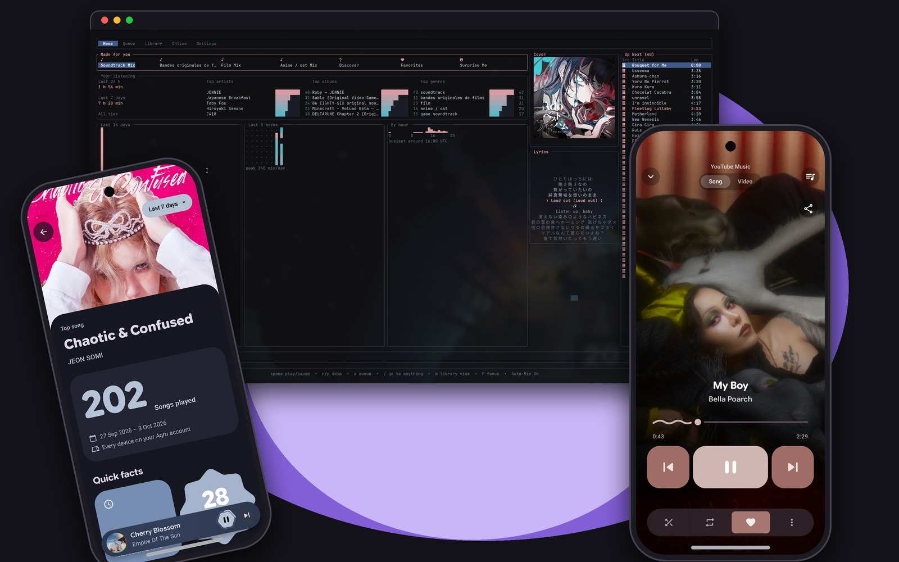
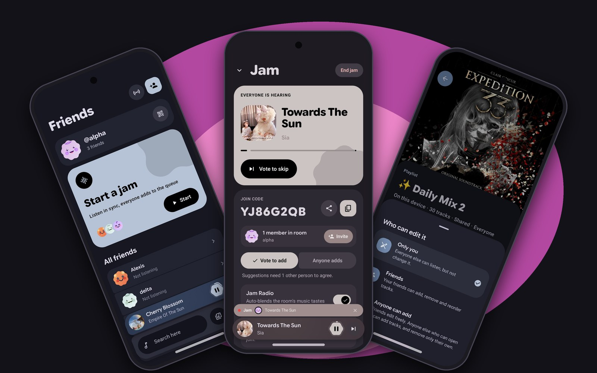

<p align="center">
  
</p>

<h1 align="center">Agro</h1>

<p align="center">
  A lightweight, self-hosted, privacy-first music sync server built in Rust under AGPL-3.0.
</p>

<p align="center">
  <a href="https://github.com/AgroUPlus/Agro/actions/workflows/ci.yml"></a>
  <a href="https://github.com/AgroUPlus/Agro/releases"></a>
  <a href="LICENSE"></a>
  
  <a href="https://sonarcloud.io/summary/new_code?id=AgroUPlus_Agro"></a>
  <a href="https://agrouplus.github.io/Agro"></a>
</p>

<p align="center">
  <a href="https://agrouplus.github.io/Agro">Website</a> ·
  <a href="https://github.com/AgroUPlus/Wanda">Wanda Android</a> ·
  <a href="https://github.com/AgroUPlus/Wander">Wander Desktop</a> ·
  <a href="SECURITY.md">Security</a> ·
  <a href="CLIENTS.md">Write a client</a> ·
  <a href="CONTRIBUTING.md">Contributing</a> ·
  <a href="CODE_OF_CONDUCT.md">Code of Conduct</a>
</p>

---

Agro keeps **playback handoff**, **library sync**, **friends**, **jam rooms** and **listening stats** in one place, so a session started on your desktop can be picked up on your phone, and your friends can follow along if you let them.

Designed for people who run their own infrastructure: one binary, one SQLite file, no external services, zero telemetry. Every social surface is off until you switch it on, and presence and handoff metadata are sealed end to end, so the server routes what it cannot read.

Agro is the optional server behind [Wanda](https://github.com/AgroUPlus/Wanda) (Android) and [Wander](https://github.com/AgroUPlus/Wander) (Linux terminal). Both players work fully on their own; Agro adds everything that needs more than one device.

<p align="center">
  
  
</p>

---

## At a Glance

| | |
|---|---|
| **20–30 MB** | Memory at idle. |
| **5,000 players** | Playing at the same time on 2 CPU cores, at 8.5 ms p95 latency ([measured](#performance)). |
| **8,000 players** | Still served on those 2 cores, in under 300 MB of memory. |
| **~1,700 pushes/s** | Live friend presence fanned out at that load, with every account sharing. |
| **No device cap** | Pair as many players per account as you like, each with its own revocable token. |
| **30 s** | Reconnect window: a phone switching from Wi-Fi to cellular resumes without missing a push. |
| **1 binary, 1 file** | The dashboard is compiled into the server; all state lives in a single SQLite file. |
| **0 external services** | No Postgres, no Redis, no message broker, no cloud account. |
| **0 telemetry** | Nothing phones home, ever. |
| **0 social switches on** | Now playing, stats and discoverability all default to off. |
| **171 boundary tests** | Five suites prove that no account can read what it should not. 205 tests in total. |
| **12 features** | Each one can be switched off server-wide from the dashboard, with its cost shown. |

---

## Welcome to Agro! (FAQ for Newcomers)

<details>
<summary><b>Do I need Agro to use Wanda or Wander?</b></summary>
<br>
No. Both players are complete on their own. Agro adds the features that need a server: handoff between devices, jam rooms, friends, shared playlists, share links and stats across all your devices. You can host it yourself or sign in to Agro Cloud.
</details>

<details>
<summary><b>What does it take to run?</b></summary>
<br>
Very little. A single Docker container or a native binary, no database server to set up, and 20–30 MB of memory at idle. A Raspberry Pi or the smallest VPS will do. Building from source needs more (~4 GB RAM), but prebuilt images and binaries are published for amd64 and arm64.
</details>

<details>
<summary><b>Can the server operator see what I listen to?</b></summary>
<br>
Less than you might expect. When a device holds a vault key, <code>HANDOFF</code> and <code>FRIEND_PRESENCE</code> messages are sealed end to end: the server forwards ciphertext it cannot open. Cloud backups are encrypted before they leave the device; the server keeps only a salt and a wrapped key. Passphrases and device tokens are stored as hashes. See <a href="SECURITY.md">SECURITY.md</a> for the full threat model.
</details>

<details>
<summary><b>Can strangers find me or see my activity?</b></summary>
<br>
Only if you allow it. A friendship is a door, not a window: friends see your now playing or stats only if you turned that on, and you appear in search only if you made yourself discoverable. Blocking is symmetric and never disclosed. See <a href="#multi-user--privacy">Multi-user & privacy</a>.
</details>

<details>
<summary><b>Does it host my music files?</b></summary>
<br>
Only if you want it to. Without <code>AGRO_LIBRARY_ROOT</code>, Agro runs <b>index-only</b>: it knows what each device holds but never keeps the bytes. Set it, and devices can upload to the library and pull files from each other.
</details>

<br>

---

## What's What

| | What it is | Needs Agro? |
|---|---|---|
| **Agro** (this repo) | The server: handoff, jam rooms, friends, shared playlists, share links, stats across devices. Self-host it, or use Agro Cloud. | — |
| **[Wanda](https://github.com/AgroUPlus/Wanda)** | The Android player: Navidrome/Subsonic, local files, YouTube Music and Deezer in one library. | No. Agro adds the shared features. |
| **[Wander](https://github.com/AgroUPlus/Wander)** | The terminal player for Linux: Navidrome/Subsonic and local files. | No. Agro adds the shared features. |

---

## Key Capabilities

### Across your devices
* **Real-time handoff**: Move playback between phone and desktop mid-track.
* **Library sync**: Agro tracks what each device holds and can relay files between them, or file uploads into your library.
* **Settings sync**: Change a setting once, every paired device follows.
* **Cloud backups**: The last three app backups per account, sealed on the device under a key the server never holds.
* **Stats & Agro Wrapped**: Listening stats and a year-in-review that cover every device, not just one.

### With your friends
* **Friends' now playing & listen along**: Follow a friend's playback live, directly or through the audio relay.
* **Jam rooms**: Build a queue together in real time, with a recap afterwards.
* **Blends**: A playlist mixed from several friends' taste, made only with everyone's consent.
* **Drops & activity feed**: Hand a song to a friend; see what friends played, if they share it.
* **Shared playlists**: Collaborative editing with followers and visibility controls.
* **Share links**: `https://your-domain/listen?v=<id>` links that forward to wherever the track lives.

### For the operator
* **Embedded dashboard**: Accounts, approvals, invites, pairing QR codes and feature switches, served at `/`.
* **Signup modes, OIDC single sign-on and TOTP two-factor**.
* **Privacy proxy**: Fetches metadata and lyrics on clients' behalf, hiding their IP addresses.
* **Fleet charts & acoustic search**: Blinded, account-free popularity counters and a crowd-averaged acoustic index.

### APIs
* **GraphQL**: `POST /graphql` (SDL at `/graphql/sdl`, GraphiQL at `/graphql/playground`).
* **REST**: Swagger UI at `/api/docs` (spec at `/api/docs/openapi.json`) for the endpoints GraphQL fits poorly: auth, uploads, relay, SSO, share links.
* **Live push**: `GET /ws/sync`, a WebSocket carrying `HANDOFF`, `NODE_UPDATE`, `SETTINGS_SYNC`, `LIBRARY_UPDATED`, `SYNC_OFFER`, `FRIEND_PRESENCE`, `FRIEND_REQUEST`, `LISTEN_ALONG`, `JAM_UPDATED` and more.

Want to build your own client? Start with [CLIENTS.md](CLIENTS.md).

---

## Install

**Docker** (amd64 and arm64):

```bash
docker run -d --name agro -p 8700:8700 \
  -v agro_data:/opt/agro/data -v ~/Music:/srv/music:ro \
  ghcr.io/agrouplus/agro
docker logs agro   # the one-time setup token is printed here
```

Or use [`docker-compose.yml`](docker-compose.yml).

**Native binary** (Linux, amd64 and arm64, no root):

```bash
curl -fsSL https://raw.githubusercontent.com/AgroUPlus/Agro/main/scripts/install.sh | sh
```

Then open `http://localhost:8700` and follow the [Quickstart](#quickstart). To compile it yourself, see [Building from Source](#building-from-source).

---

## Quickstart

The server starts with no accounts. On an empty database it prints a **one-time setup token** to the log, valid until the next restart.

**1. Find the token:**
```bash
docker logs agro                                  # Docker
journalctl -u agro | grep -A2 'setup token'      # systemd
```

**2. Create the first administrator:**
```bash
curl -s -X POST https://agro.example.com/api/v1/bootstrap \
  -H 'Content-Type: application/json' \
  -d '{"setupToken":"<from the log>","username":"alpha"}'
```
The response carries the **passphrase** and a device token, both shown once. Save the passphrase; there is no reset.

**3. Sign in to the dashboard** with the username and passphrase.

**4. Pair devices.** Clients send the passphrase once to `/api/v1/login` and receive a per-device token:
```bash
curl -s -X POST https://agro.example.com/api/v1/login \
  -H 'Content-Type: application/json' \
  -d '{"username":"alpha","passphrase":"<your passphrase>","label":"Pixel 10"}'
```

- **Wanda (Android)**: Settings → Agro Device, or scan the QR code from the dashboard's Pairing tab.
- **Wander (Linux TUI)**: `~/.config/wander/config.toml`:
  ```toml
  [agro]
  enabled = true
  server   = "https://agro.example.com"
  username = "alpha"
  passphrase = "<device token>"
  device_id  = "wander-desktop"
  sync_settings = true
  ```

`revokeAppPassword(userId:, label:)` revokes a single device: a lost phone is removed without affecting anything else.

---

## Configuration

```bash
PORT=1674 ./agro
```

The listener always binds `0.0.0.0`. The database path is **relative** (`agro_data.db`), so run from the directory you want the data to live in; under systemd, set `WorkingDirectory`.

### Core

| Variable | Description |
|---|---|
| `PORT` | Listen port. Default `8700`. |
| `AGRO_PUBLIC_URL` | Base URL used to build share links. |
| `AGRO_ALLOWED_ORIGIN` | CORS origin for the dashboard. No wildcard. |
| `AGRO_DB_READERS` | Read-only SQLite connections beside the single writer. Default `4`. |
| `AGRO_TRUSTED_PROXY` | Comma-separated proxy IPs whose forwarded client address is believed. Default: loopback and private ranges. Set it for a proxy on a public address. |

### Library & storage

| Variable | Description |
|---|---|
| `AGRO_LIBRARY_ROOT` | Music library root. **Unset = index-only**: Agro tracks what each device holds but never keeps the bytes itself. |
| `AGRO_SPOOL_ROOT` | Staging for in-flight uploads and peer transfers. Default `./spool`. |
| `AGRO_SPOOL_MAX_BYTES` | Spool budget, oldest evicted first. Default 2 GiB. |
| `AGRO_SPOOL_TTL_HOURS` | How long a spooled file waits to be collected. Default 72 h. |
| `AGRO_ARCHIVE_HOOK` | Shell command run after a file is filed. Paths arrive via env, not argv. |
| `AGRO_SCROBBLE_RETENTION_DAYS` | Delete listening history older than this. Default: kept forever. |
| `AGRO_AUDIT_RETENTION_DAYS` | Delete security events older than this. Default `180`. |

**Archive hook example** (Nextcloud):
```ini
Environment=AGRO_ARCHIVE_HOOK=docker exec -u www-data nextcloud php occ files:scan --path="alpha/files/Music"
```
Archived files are created `0664`, so a setgid library shared with another service stays writable by both.

### Accounts & security

| Variable | Description |
|---|---|
| `AGRO_SIGNUP` | `approval` (default), `invite`, or `closed`. See [Multi-user & privacy](#multi-user--privacy). |
| `AGRO_SECRET_KEY` | Encrypts two-factor secrets at rest. Optional: unset, the server generates one into `agro_secret.key` beside the database (mode 0600), so keep that file with your backups. Never change it afterwards, or enrolled secrets stop opening. |
| `AGRO_REQUIRE_TOTP_ADMIN` | `1` makes two-factor mandatory for administrators. Default off: recommended, never forced. |
| `AGRO_TOTP_ISSUER` | Name shown in authenticator apps. Default `Agro`. |
| `AGRO_TOKEN_IDLE_DAYS` | A device token unused for this long expires. Default `180`. |
| `AGRO_TOKEN_TTL_DAYS` | Hard ceiling on a device token's age. Default: none. |

### Single sign-on (OIDC)

Enabled when the first four are set.

| Variable | Description |
|---|---|
| `AGRO_OIDC_ISSUER` | Your identity provider's issuer URL. |
| `AGRO_OIDC_CLIENT_ID` / `AGRO_OIDC_CLIENT_SECRET` | Client credentials registered with the provider. |
| `AGRO_OIDC_REDIRECT_URI` | The callback URL registered with the provider. |
| `AGRO_OIDC_DISPLAY_NAME` | Label on the sign-in button. Default `SSO`. |
| `AGRO_OIDC_SCOPES` | Default `openid profile email`. |
| `AGRO_OIDC_AUTO_APPROVE` | `1` lets new SSO accounts skip the approval queue. |

### Turning features off

**Management → Plugins & Rules** in the dashboard lists every server feature that costs CPU, disk or bandwidth, with what each one costs, and lets an admin switch it off for the whole server: audio relay, library uploads & transfers, the privacy proxy, share links, friends' now playing, listen along, jams, acoustic search, Agro Wrapped, the popular chart, blends and cloud backups.

A feature that is off is refused: `403` with `"code": "FEATURE_DISABLED"` over HTTP, a GraphQL error with the same code. Clients read the current state from `serverFeatures`. Everything is on until switched off, and switching a feature back on loses nothing.

---

## Running in Production

### systemd

```ini
[Unit]
Description=Agro sync server
After=network-online.target

[Service]
Type=simple
User=agro
SupplementaryGroups=www-data
UMask=0002
WorkingDirectory=/opt/agro
Environment=PORT=1674
Environment=AGRO_LIBRARY_ROOT=/srv/music
ExecStart=/opt/agro/agro
Restart=always
RestartSec=5
ProtectSystem=strict
ReadWritePaths=/opt/agro /srv/music
PrivateTmp=true
NoNewPrivileges=true

[Install]
WantedBy=multi-user.target
```

```bash
systemctl enable --now agro
journalctl -fu agro
```

### Behind a reverse proxy

Agro speaks plain HTTP and expects TLS to be terminated upstream. Three routes need non-default proxy config:

| Route | Issue with defaults |
|---|---|
| `GET /ws/sync` | Needs WebSocket upgrade, or clients silently never receive pushes. |
| `PUT /api/v1/library/upload/{id}` | Rejected at `client_max_body_size` (nginx default 1 MB). |
| `/api/v1/relay/{id}/send` + `/receive` | With `proxy_buffering on` the receiver gets nothing until a buffer fills: the transfer hangs, then times out. |

<details>
<summary><b>Caddy</b> (recommended, no extra config needed)</summary>

```caddyfile
agro.example.com {
    reverse_proxy 127.0.0.1:1674
}
```
</details>

<details>
<summary><b>Nginx Proxy Manager</b></summary>

Enable **Websockets Support**, then add to **Advanced → Custom Nginx Configuration**:

```nginx
client_max_body_size 0;

location /api/v1/relay/ {
    proxy_pass http://192.168.1.16:1674;
    proxy_http_version 1.1;
    proxy_buffering off;
    proxy_request_buffering off;
    proxy_read_timeout 1h;
    proxy_send_timeout 1h;
    proxy_set_header Host $host;
    proxy_set_header X-Real-IP $remote_addr;
}
```
</details>

<details>
<summary><b>Plain nginx</b></summary>

```nginx
location / {
    proxy_pass http://127.0.0.1:1674;
    proxy_http_version 1.1;
    client_max_body_size 0;
    proxy_set_header Host $host;
    proxy_set_header Upgrade $http_upgrade;
    proxy_set_header Connection "upgrade";
}

location /api/v1/relay/ {
    proxy_pass http://127.0.0.1:1674;
    proxy_http_version 1.1;
    proxy_buffering off;
    proxy_request_buffering off;
    proxy_read_timeout 1h;
    proxy_send_timeout 1h;
}
```
</details>

### Performance

The running server idles at **20–30 MB RSS**.

Measured with [`scripts/loadtest/`](scripts/loadtest) on two pinned cores, every connected device sending a playback heartbeat every 30 s, ten friends per account:

| Devices online at once | p95 latency | CPU (of 2 cores) | RSS |
|---|---|---|---|
| 5,000 | 8.5 ms | 0.6 | 189 MB |
| 6,500 | 16 ms | 1.0 | 240 MB |
| 8,000 | 145 ms | 1.5 | 295 MB |

This is a worst case: every account shares its now playing with all ten friends, so 5,000 players mean ~167 heartbeats and ~1,700 presence pushes every second. Each additional connected player costs roughly 35 KB of memory.

Relayed audio and uploads are bounded by bandwidth rather than CPU, and are not in these numbers. Friends' now playing is the largest share of CPU on a busy server; it can be [switched off](#turning-features-off).

### Capacity & limits

Agro has no cap on players, devices per account or people in a jam. The ceiling is your hardware, as measured above. The limits it does enforce exist to protect privacy or keep one client from starving the others:

| | Limit |
|---|---|
| **Players online** | No cap. 5,000 on 2 cores at 8.5 ms p95; 8,000 at 145 ms p95. |
| **Devices per account** | No cap. Each has its own token, revocable alone. |
| **Jam room members** | No cap. The room clock checks track boundaries every 2 s; a listener who falls behind is dropped from the audio fanout instead of stalling the host. |
| **Empty jam room** | Kept 5 minutes, so members who lose signal can rejoin. |
| **Reconnect replay** | Missed pushes are replayed for 30 s after a reconnect; after that the client resyncs. |
| **Uploads** | Up to 2 GiB per file. |
| **Cloud backups** | Last 3 per account, up to 8 MB each, sealed on the device. |
| **Popular chart** | A track appears only once at least 5 plays agree, so no single listener can be singled out. |
| **Group recaps** | Up to 25 friends per circle. |
| **Login, signup, bootstrap** | 10 attempts per 5 minutes per IP. |
| **Song drops** | 20 per hour per account. |

### Deploying from a workstation

```bash
./deploy.sh <user@host>
# or: AGRO_DEPLOY_HOST=user@host ./deploy.sh
```

Builds the dashboard and the server locally (the Rust binary inside a Debian 12 container for glibc compatibility), uploads the result, and restarts the service. The target never compiles anything.

---

## Multi-user & Privacy

Set `AGRO_SIGNUP` and `POST /api/v1/signup` opens to strangers:

| `AGRO_SIGNUP` | Behaviour |
|---|---|
| `approval` | Anyone may register; accounts start `pending` until approved in the dashboard's **People** tab. An invite code skips the queue. |
| `invite` | A valid code is required to register. |
| `closed` | Registrations refused. |

### Privacy model

A friendship is a door, not a window: every social surface is gated on the **account being looked at**, and **every switch defaults off**:

| Switch | What it reveals |
|---|---|
| `showNowPlaying` | Friends may see what you're playing and listen along. |
| `showStats` | Friends may see your listening stats and taste overlap. |
| `discoverable` | You appear in `searchUsers`, the only way a stranger can find you. |

Search is prefix-anchored and returns only discoverable, active accounts. Blocking is symmetric and never disclosed to the blocked account. Every refusal on this path is deliberately identical, so error messages cannot be used to walk the directory.

`src/social_boundary_tests.rs` keeps these guarantees from quietly reopening.

---

## Share Links

With `AGRO_PUBLIC_URL` set and Share Links configured in the dashboard, Wanda and Wander replace server-specific URLs (your music server, YouTube) with `https://your-domain/listen?v=<id>`. Agro forwards whoever opens one to where the track actually lives.

Set up in the dashboard under **Share Links**:
1. **Share Domain**: your domain, pointed at this server.
2. **Forward To**: your music server's host(s). Everything not listed is refused.
3. **On** → **Sync to Devices**.

`/listen` is public and records nothing. The wire format is in [`SHARE_LINKS.md`](SHARE_LINKS.md).

---

## Authentication & Security

All `/graphql` and `/ws/sync` requests require `Authorization: Bearer <device token>`. WebSocket handshakes also accept `?token=`.

**A passphrase is not a bearer token.** It is Argon2-hashed, accepted only by `/api/v1/login`, which returns a per-device credential you can revoke independently.

Public routes (no token needed):

| Route | Purpose |
|---|---|
| `POST /api/v1/bootstrap` | Creates the first admin. Requires the setup token; refused once any account exists. |
| `POST /api/v1/login` | Trades a passphrase for a device token. |
| `POST /api/v1/signup` | Registers a new user, when `AGRO_SIGNUP` allows it. |
| `GET /share/{token}`, `GET /listen` | Capability URLs: the token in the path is the credential. |

All three mutation routes are rate-limited (10 attempts / 5 min per IP). Full request and response shapes, including errors, are documented interactively at `/api/docs`.

### Hardening

1. **No replayable credential at rest**: passphrases stored as **Argon2** hashes, device tokens as **SHA-256** hashes.
2. **Identity checks on every field**: each GraphQL field that names a `userId` checks it against the token's identity and answers `Forbidden` otherwise.
3. **Boundary suites under `cargo test`**: guest, social, catalog, playlist and blend boundaries — 171 tests that must never be loosened.
4. **No shell injection**: the archive hook receives file paths via environment variables, not argv, so client-supplied filenames cannot reach the shell parser.

`agro_data.db` holds listening history and should not be world-readable (it is gitignored). Report vulnerabilities as described in [SECURITY.md](SECURITY.md).

---

## Building from Source

Requires a **Rust** toolchain and **Node 20+**. SQLite is bundled, so there is no system dependency.

The React dashboard is embedded into the Rust binary via `rust-embed`, so **build the dashboard first**: a fresh clone has no `dashboard/dist/` and `cargo build` will fail.

```bash
cd dashboard && npm ci && npm run build
cd .. && cargo build --release

# Run the test suite, including the boundary suites
cargo test
```

Building needs ~4 GB RAM and ~12 GB disk. Use `cargo build --release -j2` if memory is tight.

---

## License

**AGPL-3.0**: see [`LICENSE`](LICENSE).

Section 13 is the part that matters for a server: run a modified Agro where other people can reach it and those people must be offered its source. The project is given away; what is sold is running it.

Contributions require agreement to [`CLA.md`](CLA.md); see [`CONTRIBUTING.md`](CONTRIBUTING.md).
